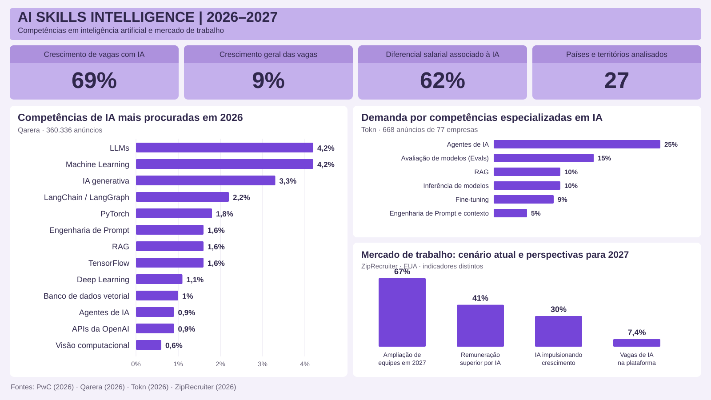

# AI Skills Intelligence | 2026–2027

Estudo exploratório de Business Intelligence sobre competências em inteligência artificial e perspectivas do mercado de trabalho. Desenvolvido em Power BI Desktop com base estruturada em Excel, visuais nativos e tema JSON personalizado.

## Visualização da dashboard

*Prévia vetorial reconstruída a partir da dashboard desenvolvida em Power BI e dos indicadores documentados. Não é uma captura de tela nem o relatório interativo original.* [Abrir imagem ampliada](dashboard-preview.svg).

## Objetivo
Identificar competências demandadas em anúncios de emprego, compreender a valorização profissional associada à IA e interpretar expectativas de contratação para 2027. O estudo não pretende prever salários individuais nem representar exclusivamente o Brasil.

## Metodologia
Foram organizados indicadores secundários de quatro levantamentos, mantendo separados os respectivos universos, períodos, geografias e unidades. A planilha original possui oito abas: mercado, ranking, especializadas, Brasil, perspectivas, tendências, fontes e orientações. Sete tabelas foram importadas no Power BI. A página apresenta quatro cartões e três gráficos. Percentuais foram armazenados como frações decimais e formatados no relatório; os cartões usam filtros por indicador. Não foram criadas medidas DAX personalizadas. Não se somam percentuais de competências ou amostras repetidas.

## Resultados
### Mercado — PwC
O levantamento registrado cobre 27 países e territórios e mais de um bilhão de anúncios. Crescimento de vagas com competências de IA: 69%; crescimento geral: 9%; diferencial salarial associado à IA: 62%. A diferença de crescimento é de 60 pontos percentuais. O diferencial salarial é uma associação observada, não uma garantia de remuneração nem prova de causalidade.

### Competências técnicas — Qarera
Amostra registrada: 360.336 anúncios, dezembro de 2025 a junho de 2026. Percentuais de anúncios que mencionam as competências selecionadas:

| Competência | Percentual |
|---|---:|
| Machine Learning | 4,2% |
| LLMs | 4,2% |
| IA generativa | 3,3% |
| LangChain / LangGraph | 2,2% |
| PyTorch | 1,8% |
| TensorFlow | 1,6% |
| Engenharia de Prompt | 1,6% |
| RAG | 1,6% |
| Deep Learning | 1,1% |
| Banco de dados vetorial | 1,0% |
| Agentes de IA | 0,9% |
| APIs da OpenAI | 0,9% |
| Visão computacional | 0,6% |

Machine Learning e LLMs lideram o recorte selecionado, sugerindo relevância tanto dos fundamentos de aprendizado de máquina quanto das aplicações de linguagem. A presença de frameworks, RAG e bancos vetoriais sinaliza a importância de integrar modelos a sistemas e informações externas. Uma vaga pode mencionar várias habilidades.

### Vagas especializadas — Tokn
Recorte europeu registrado: 668 anúncios de 77 empresas, outubro de 2026.

| Competência | Percentual |
|---|---:|
| Agentes de IA | 25% |
| Avaliação de modelos (Evals) | 15% |
| RAG | 10% |
| Inferência | 10% |
| Fine-tuning | 9% |
| Engenharia de Prompt e contexto | 5% |

Agentes e avaliação destacam-se neste recorte. A leitura estratégica é que construir soluções e verificar seu comportamento são competências complementares. Não é válido comparar diretamente os 25% deste recorte com os 0,9% de agentes do levantamento Qarera como crescimento temporal, pois as populações diferem.

### Perspectivas — ZipRecruiter
Pesquisa registrada com mais de 1.500 responsáveis por contratações nos EUA. 67% esperam ampliar equipes em 2027; 30% apontam IA como impulsionadora do crescimento das equipes. Entre os indicadores observados em 2026, 41% oferecem remuneração superior por competências de IA e 7,4% das vagas na plataforma estavam relacionadas à IA em outubro. Esses indicadores possuem denominadores e interpretações distintos; não são partes de um total. Expectativas não são contratações realizadas.

## Recomendações de desenvolvimento profissional
As prioridades abaixo são interpretação do estudo, não um ranking previsto para 2027.

1. **Fundamentos de LLMs e integração:** aprender tokens, contexto, limites, APIs REST, JSON e Python; construir uma aplicação que registre erros, latência e custo.
2. **Engenharia de prompt e contexto:** formular instruções, definir critérios de aceitação, exemplos e saídas estruturadas. Comparar versões de prompts com um conjunto fixo de testes, em vez de avaliar apenas respostas isoladas.
3. **RAG:** aprender embeddings, segmentação, recuperação, bancos vetoriais e citações. Testar recuperação relevante, respostas fundamentadas e comportamento quando não há evidência.
4. **Avaliação de IA (QA/Evals):** criar casos de teste de precisão, consistência, segurança, regressão e aderência às instruções; documentar resultados esperados e observados. Esta é uma ponte especialmente promissora entre QA e IA aplicada.
5. **Agentes e automação:** estudar ferramentas, orquestração, n8n e LangGraph; definir permissões, limites de execução, tratamento de falhas e aprovação humana para ações sensíveis.
6. **Estratégia de IA e analytics:** entender problemas de negócio, selecionar indicadores de sucesso, medir custo-benefício, produtividade e riscos; comunicar resultados com Power BI e storytelling de dados.
7. **Governança e fundamentos de ML:** estudar privacidade, vieses, monitoramento, métricas de classificação e validação; aprofundar PyTorch, TensorFlow e fine-tuning conforme a função pretendida.

Uma trilha prática para quem busca QA ou IA aplicada seria começar com APIs, Python e prompts, avançar para RAG e testes sistemáticos e só então adicionar agentes e automação. Para funções de engenharia de modelos, aprofundar estatística, matemática e aprendizado de máquina mais cedo. Para funções de estratégia, priorizar indicadores de negócio, governança e comunicação. Não é necessário dominar todas as ferramentas simultaneamente.

## Qualidade dos dados e limitações
O relatório de validação de 24/11/2026 registra 27/27 indicadores conferidos (PwC: 4; Qarera: 13; Tokn: 6; ZipRecruiter: 4) e nenhuma divergência identificada na conferência anterior. Trata-se do registro dessa etapa, não de uma nova auditoria independente das fontes ou dos microdados. O arquivo PBIX não foi executado nesta revisão. O recorte não constitui ranking exaustivo, não permite inferência causal e não garante tendências futuras. O levantamento qualitativo brasileiro do LinkedIn é complementar, sem classificação numérica comparável aos demais.

## Referências
- [PwC — Global AI Jobs Barometer 2026](https://www.pwc.com/gx/en/news-room/press-releases/2026/pwc-2026-ai-jobs-barometer.html)
- [Qarera — Most In-Demand Skills of 2026](https://www.qarera.com/reports/most-in-demand-skills-2026)
- [Tokn — Most In-Demand AI Skills in 2026](https://www.toknjobs.com/blog/most-in-demand-ai-skills)
- [ZipRecruiter — Employer Report 2026](https://www.ziprecruiter-research.org/economic-insights-research/annual-employer-report-2026)
- [LinkedIn — Skills on the Rise 2026](https://news.linkedin.com/2026/Skills-on-the-rise-2026)

Os números e referências acima reproduzem os arquivos de trabalho e o relatório de validação fornecidos; não constituem nova verificação externa.

## Conclusão
A análise indica que combinar fundamentos técnicos, integração de IA, avaliação de qualidade e compreensão de negócios é um caminho de capacitação justificável pelos recortes estudados. O diferencial profissional não se limita a utilizar ferramentas: envolve definir problemas, construir soluções verificáveis e demonstrar resultados com dados.

## Arquivos disponíveis
- [Base numérica em CSV](dados/indicadores.csv) — versão consolidada de 27 indicadores.
- [Registro de validação](docs/validacao.md) — versão textual resumida do relatório fornecido.
